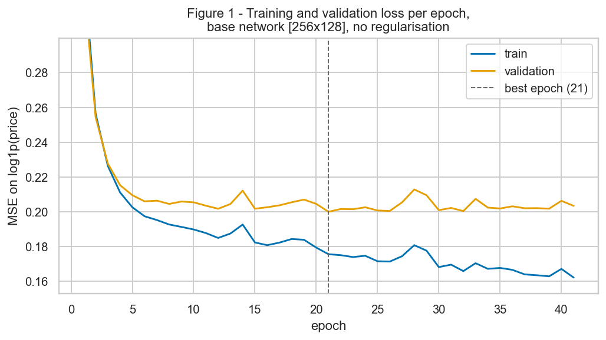
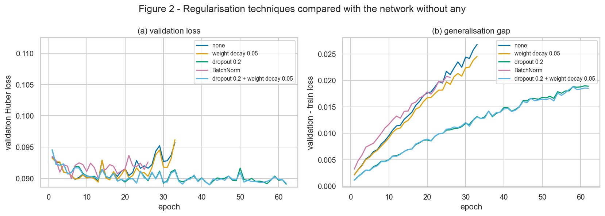
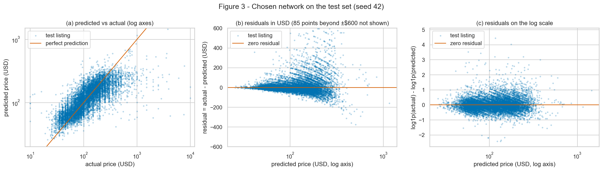
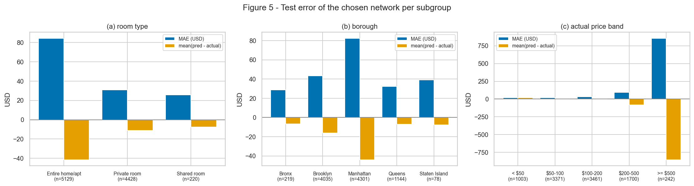
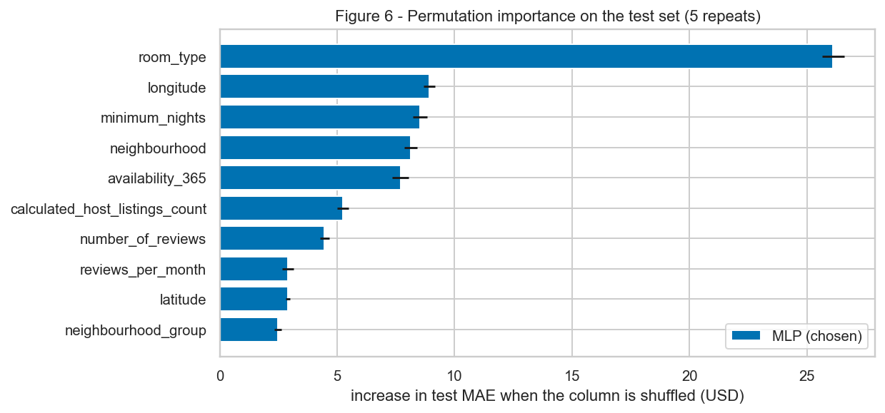

# Regression - NYC Airbnb price with a neural network

**Team:** Gustavo Cruz, Henrique Mayor and Pedro Fardin.

**Task:** regression. **Target:** `price` (USD per night). **Main metric:** MAE in dollars on the test set.

This is the second delivery of the project. The [EDA](../eda/index.md) built the preprocessing pipeline; here we train a multilayer perceptron on top of it and ask two questions: does the network learn something that simpler models do not, and how far can the number it reports be trusted?

Everything below comes out of one script, from a clean clone:

```bash
pip install -r requirements.txt
python code/regression.py    # ~6 min on a GPU, CPU works too (slower)
```

The script writes every figure to `figures/` and every number quoted here to [`results.json`](https://github.com/henriquessm/nyc-airbnb-project/blob/main/docs/projects/regression/results.json). The network and its training loop are in [`code/model.py`](https://github.com/henriquessm/nyc-airbnb-project/blob/main/code/model.py), the experiment in [`code/regression.py`](https://github.com/henriquessm/nyc-airbnb-project/blob/main/code/regression.py). Seeds are fixed everywhere (`random_state=42` for the split, seeds 42 to 46 for the networks), and the seed is set before the network is built, so it fixes the initial weights as well as the batch order.

---

## 0. Starting point

**Data and split.** Same file, same row filter (the 11 listings with `price == 0` removed) and the **same 80/20 split as the EDA**, seed 42, stratified on deciles of `log1p(price)`: 39,107 training rows and 9,777 test rows. The validation set comes out of the training set: 15% of it, with the same seed and the same stratification, so the three sets have the same price range (median $106 in all three).

| set | rows | used for |
|---|---|---|
| train | 33,240 | fitting the pipeline and every model |
| validation | 5,867 | early stopping, every choice of model and hyperparameter |
| test | 9,777 | section 5 only, once, after everything was frozen |

**Pipeline.** The `ColumnTransformer` from `code/preprocess.py` is imported as is and **fitted on the 33,240 training rows only**; validation and test are only transformed. Because it is fitted on fewer rows than in the EDA, five fewer neighbourhoods reach the 30-listing threshold, so the output has **119 features instead of 124** (104 neighbourhood columns, the last one being the `infrequent` bucket; 3.1% of the validation rows fall in it). Nothing else changed. The model is trained on `log1p(price)` (`transform_target()`, EDA section 1C: skewness 19.1 on the raw price, 0.63 on the log) and every prediction is brought back with `expm1` before any metric is computed, so **all metrics are in dollars**.

**Main metric: MAE in USD on the test set.** The target has a tail that no metric can ignore (kurtosis 585.6, one listing at $10,000). RMSE squares the errors and would be decided by the 62 test listings above $1,000; MAE treats a $50 error as a $50 error wherever it happens and is the number a host understands. It also matches the way we train: a model fitted on the log predicts something close to the conditional median of the price, and the median is what minimises the absolute error. RMSE, R² and MedAE are reported next to it.

**Success criterion, written before training any network:**

> The network's test MAE (mean over 5 seeds) is **at least 10% lower than the MAE of the best of the trivial and linear baselines**, and the gap is larger than the variation between seeds.

Why 10% and not more: the EDA found that group means of log-price by room type × neighbourhood already explain 53.7% of its variance on the training set. A linear model with one-hot room type and neighbourhood captures most of that for free; what is left for the network is the 2-D shape of the map (EDA Figure 9) and the interactions between room type, location and how the listing is operated (EDA section 3C). A 10% cut in MAE on top of a linear model is what we expected those interactions to be worth.

---

## 1. Baselines

All baselines use the same pipeline output (119 features) and the same log target, are fitted on train and evaluated on **validation**:

- **Trivial:** `DummyRegressor(strategy="mean")` on `log1p(price)`, which predicts the constant $113.12 for every listing, and `DummyRegressor(strategy="median")` on the price in dollars, which predicts $106.
- **Linear:** `Ridge`, with `alpha` chosen on validation among 0.01, 0.1, 1, 10 and 100. The MAE is $61.00 to $61.02 for every alpha up to 10 and $61.13 at 100: with 33,240 rows for 119 features the penalty barely matters. `alpha = 10` was kept.
- **Optional:** `HistGradientBoostingRegressor` with default settings (`random_state=42`), as a nonlinear reference.

| model (validation) | MAE ($) | RMSE ($) | R² | MedAE ($) | R² on log-price |
|---|---|---|---|---|---|
| Dummy, mean of log (constant $113.12) | 85.96 | 240.07 | -0.031 | 48.12 | 0.000 |
| Dummy, median (constant $106) | 85.80 | 241.40 | -0.042 | 46.00 | -0.009 |
| Ridge (`alpha=10`) | **61.00** | 221.40 | 0.124 | 25.74 | 0.564 |
| Gradient boosting | 58.11 | 217.61 | 0.153 | 24.05 | 0.612 |

Reading the table:

- Ridge removes **29% of the error of the trivial model** ($85.80 → $61.00). This is the best of the two required baselines, so it is the reference for the criterion of step 0.
- R² in dollars is low for every model (0.12 for Ridge) while R² on the log scale is 0.56. Both are correct: the dollar R² is dominated by the squared errors on the few listings at several thousand dollars, which no model gets right (section 6). The log R² of Ridge (0.564) is close to the 0.537 of the group means in the EDA, which is what a linear model on one-hot categories should give.
- Gradient boosting is already $2.89 better than Ridge. Trees capture interactions without being told, so this gap is a first measure of the nonlinear structure available, and a realistic target for the network.

---

## 2. The network

The network is a plain MLP in PyTorch (`code/model.py`, class `MLP`):

```
input (119) -> Linear 256 -> ReLU -> [Dropout] -> Linear 128 -> ReLU -> [Dropout] -> Linear 1
```

The base configuration is two hidden layers of **256 and 128 units**, no regularisation; the version that went to the test set adds dropout 0.2 (section 4). Every choice:

- **Two hidden layers.** One hidden layer is enough in theory (universal approximation), but the theorem says nothing about how many units it takes. The EDA showed a structure in two levels: a categorical cell first (room type × borough), then a continuous gradient inside the cell (EDA Figures 17-18). Two layers let the first build features such as "entire home in lower Manhattan" and the second combine them. A third layer was tried in the search (section 4) and did not help.
- **Widths 256 → 128.** The first layer is wider than the input (119) so that it has room for combinations of inputs, then the width halves towards the single output. The search also tried 128 → 64 and 512 → 256.
- **ReLU.** Its derivative is exactly 1 where the unit is active, so the gradient is not shrunk on the way back (a sigmoid shrinks it by at least 4 per layer), and it is the default for MLPs on tabular data.
- **He (Kaiming) initialisation** for the hidden layers, biases at zero. The variance of the activations is multiplied at each layer by n·σ²·ρ, with n the fan-in and ρ = 1/2 for ReLU (it zeroes half of the inputs); He sets σ² = 2/n so the factor is 1. PyTorch's default for `nn.Linear` has variance 1/(3n), a sixth of that. With two layers either would train, but He is the one made for ReLU.
- **Output: 1 linear unit**, no activation, because log-price is an unbounded real number. Its bias starts at the mean of the training log-price (4.737, i.e. $113): the network starts exactly at the trivial baseline instead of spending the first epochs learning the offset.
- **Loss: Huber with δ = 1 on `log1p(price)`** (`nn.HuberLoss(delta=1.0)`). The EDA found prices that are not real prices: $10,000 listings, "blocking" prices on closed calendars. On the log scale most residuals are within ±1 (a factor of e ≈ 2.7 on the price; Figure 3c), and there Huber is the squared error. Beyond 1 it grows linearly, so a $9,999 listing predicted at $117 (a log residual of 4.4) pulls the weights like a residual of 4.4, not like 4.4² = 19. MSE on the log would let a few placeholder prices steer the fit; MAE would be robust but has a constant gradient that does not shrink near the optimum.

**Number of parameters.**

| layer | computation | parameters |
|---|---|---|
| hidden 1 | 119 × 256 + 256 | 30,720 |
| hidden 2 | 256 × 128 + 128 | 32,896 |
| output | 128 × 1 + 1 | 129 |
| **total** | | **63,745** |

That is **1.92 parameters per training row** (63,745 / 33,240). The network has more than enough capacity to memorise noise, and Figure 1(b) shows that it does if nobody stops it. This is why early stopping (section 3) is not optional, and why section 4 tries to regularise it.

---

## 3. Training

| setting | value | reason |
|---|---|---|
| optimizer | **AdamW** | Adam is the course's starting point for an MLP on tabular data: one learning rate works for all layers because each parameter's step is rescaled by the running size of its gradients. AdamW is Adam with the weight decay applied directly to the weights instead of through the gradient, which matters in section 4. Biases and normalisation gains are not decayed. |
| learning rate | **1e-3** | Adam's usual default. The search (section 4) tried 3e-4 and 3e-3: 3e-3 stops at epoch 6 with a worse MAE ($59.14 vs $58.50 for the same network), 3e-4 needs 71 epochs to get to the same place. |
| batch | **256** | Inside the usual 32-512 range: 130 updates per epoch, a gradient estimate with noise ∝ 1/√B that is neither too noisy nor too smooth, and fast on the GPU. |
| epochs | **up to 300, patience 20** | Validation loss is evaluated after every epoch; training stops when it has not improved for 20 epochs and the **best weights are restored**. The validation curve has bumps that last 3-4 epochs (Figure 1a), so a patience of 20 does not stop on noise. |

The loop (`train()` in `code/model.py`) is the course's skeleton: train on shuffled mini-batches, switch to `model.eval()` and compute the validation loss under `torch.no_grad()`, keep a copy of the `state_dict` whenever it improves, stop after `patience` epochs without improvement and load the best copy back. The copy is kept in memory instead of `best.pt` on disk, which is the same thing. Both curves are computed in eval mode on the whole set at the end of each epoch, so dropout does not make the training curve look worse than it is.



**Reading Figure 1.** The validation loss starts at 0.0933 at epoch 1, already close to its best, because the output bias starts at the mean and Adam moves fast. It reaches its **minimum of 0.0895 at epoch 13**; the training loss at that point is 0.078. After that the two curves separate: the training loss keeps falling (0.069 when early stopping fires at epoch 33) while the validation loss drifts up to 0.096. **Overfitting starts around epoch 13.** Panel (b) is the same network left for 120 epochs without early stopping: training loss 0.047, validation loss 0.109 at the end, the textbook shape of a model memorising the training set. It converges, quickly, and then it overfits; early stopping gives back the epoch-13 weights.

---

## 4. Regularisation and hyperparameters

### Techniques compared

Four variants of the base network, same seed, same everything else, compared with the network without any regularisation. All numbers on validation, at the best epoch:

| variant | val MAE ($) | val loss | best epoch | gap (val - train loss) |
|---|---|---|---|---|
| none | 58.50 | 0.0895 | 13 | 0.0115 |
| weight decay 0.05 (AdamW) | 58.54 | 0.0894 | 13 | 0.0110 |
| **dropout 0.2** | **58.03** | **0.0890** | 42 | 0.0142 |
| BatchNorm | 58.95 | 0.0900 | 6 | 0.0081 |
| dropout 0.2 + weight decay 0.05 | 58.12 | 0.0890 | 42 | 0.0141 |



- **Dropout 0.2** (each hidden unit switched off with probability 0.2 during training, the survivors scaled by 1/0.8, nothing switched off at evaluation) is the only technique that improves validation: $58.03 vs $58.50. Figure 2(b) shows why: the generalisation gap grows **about half as fast per epoch** (0.006 at epoch 13 against 0.0115 without it), so the network can train for 42 epochs instead of 13 before validation turns. The gap at the best epoch is larger only because it is reached much later.
- **Weight decay 0.05** changes almost nothing. With AdamW each step multiplies the weights by (1 - lr·λ) = (1 - 5·10⁻⁵); over the ~1,700 steps before early stopping that is a shrinkage of about 8%. Early stopping already limits how far the weights travel, so the extra penalty arrives too late to matter. Added to dropout it does not help either ($58.12).
- **BatchNorm** after each hidden linear layer (before the ReLU, dropout would go after it) converges fastest (best epoch 6) and has the smallest gap, but the worst MAE ($58.95). Our inputs are already standardised by the pipeline, so there is little scale to fix, and the noise BatchNorm injects through the batch statistics did not translate into a better fit here.

The differences are small: all five variants are within $0.92 of each other. The table says dropout is the one worth keeping; it does not say regularisation transforms this model.

### Search

The grid has 216 combinations: hidden layers (128, 64), (256, 128), (512, 256) or (256, 256, 128); learning rate 3e-4, 1e-3 or 3e-3; weight decay 0, 0.01 or 0.1; dropout 0, 0.1 or 0.3; BatchNorm or not. We sampled **12 of them at random** (seed 42), added the base network and the four variants above, and trained all **17 configurations** with early stopping, batch 256. The rule, fixed before running it, is the lowest validation MAE. Sorted:

| # | configuration | params | best epoch | val MAE ($) | val RMSE ($) | val MedAE ($) |
|---|---|---|---|---|---|---|
| 1 | **[256×128] lr 1e-3, dropout 0.2** | 63,745 | 42 | **58.03** | 219.06 | 23.19 |
| 2 | [256×128] lr 1e-3, dropout 0.2, wd 0.05 | 63,745 | 42 | 58.12 | 218.95 | 23.09 |
| 3 | [256×256×128] lr 1e-3 | 129,537 | 13 | 58.21 | 219.90 | 23.20 |
| 4 | [512×256] lr 1e-3, wd 0.01, dropout 0.1, BN | 194,561 | 21 | 58.32 | 219.42 | 23.36 |
| 5 | [512×256] lr 3e-3, dropout 0.1, BN | 194,561 | 21 | 58.35 | 219.34 | 23.75 |
| 6 | [128×64] lr 1e-3, dropout 0.1 | 23,681 | 55 | 58.43 | 218.01 | 23.74 |
| 7 | [128×64] lr 3e-3, wd 0.01 | 23,681 | 13 | 58.50 | 219.13 | 23.77 |
| 8 | [256×128] lr 1e-3 (base) | 63,745 | 13 | 58.50 | 219.11 | 23.26 |
| 9 | [256×256×128] lr 3e-3, wd 0.1, dropout 0.3, BN | 130,817 | 54 | 58.51 | 219.86 | 24.09 |
| 10 | [256×128] lr 1e-3, wd 0.05 | 63,745 | 13 | 58.54 | 219.07 | 23.23 |
| 11 | [512×256] lr 3e-4, dropout 0.3, BN | 194,561 | 71 | 58.56 | 218.77 | 24.09 |
| 12 | [256×128] lr 3e-3, BN | 64,513 | 13 | 58.64 | 219.67 | 24.24 |
| 13 | [512×256] lr 3e-3, wd 0.1, dropout 0.1, BN | 194,561 | 26 | 58.95 | 217.52 | 24.62 |
| 14 | [256×128] lr 1e-3, BN | 64,513 | 6 | 58.95 | 218.87 | 24.32 |
| 15 | [128×64] lr 1e-3 | 23,681 | 17 | 59.07 | 218.22 | 24.42 |
| 16 | [256×128] lr 3e-3 | 63,745 | 6 | 59.14 | 218.08 | 25.01 |
| 17 | [256×256×128] lr 3e-3, wd 0.1 | 129,537 | 6 | 59.41 | 217.02 | 25.08 |

**Chosen: [256×128], ReLU, dropout 0.2, AdamW lr 1e-3, no weight decay, batch 256.** Patterns in the table: dropout appears in 5 of the top 6; the three runs that stopped at epoch 6 (lr 3e-3, or BatchNorm, without dropout) are among the bottom four; size matters little, every width from 23,681 to 194,561 parameters appears both in the top half and in the bottom half.

**How much the ranking can be trusted.** The whole table spans $1.38, and the top 8 are within $0.47. Section 5 retrains the chosen configuration with 5 seeds: its validation MAE varies from $58.03 to $58.53 (standard deviation $0.19) just by changing the seed. The configuration we chose was evaluated on its luckiest seed (the mean over the 5 seeds is $58.34), which is the selection optimism the course warns about: pick the best of 17 noisy numbers and the winner is partly the noise. The top 3 or 4 configurations are statistically the same model; we report the one the rule picked and do not claim it is better than the runners-up.

---

## 5. Test evaluation

The chosen configuration was trained again from scratch with **5 seeds (42 to 46)**, each with early stopping on the same validation set, and each evaluated **once** on the test set. The baselines were fitted in section 1 and are evaluated on the same test rows; gradient boosting was also run with the same 5 seeds. Nothing in sections 1-4 was chosen with the test set, and the test set was not used to change anything afterwards.

| model (test, 9,777 rows) | MAE ($) | RMSE ($) | R² | MedAE ($) | MAPE (%) | R² on log-price |
|---|---|---|---|---|---|---|
| Dummy, mean of log | 86.06 | 267.74 | -0.025 | 48.12 | 60.94 | 0.000 |
| Dummy, median | 85.93 | 268.94 | -0.034 | 46.00 | 56.99 | -0.009 |
| Ridge | 62.18 | 252.34 | 0.090 | 26.27 | 34.45 | 0.550 |
| Gradient boosting (5 seeds) | **58.71 ± 0.08** | 246.87 ± 0.52 | 0.129 ± 0.004 | 23.97 ± 0.09 | 32.21 ± 0.10 | 0.603 ± 0.001 |
| **MLP, chosen (5 seeds)** | **59.10 ± 0.23** | 248.47 ± 1.10 | 0.118 ± 0.008 | **23.59 ± 0.09** | **31.83 ± 0.27** | 0.589 ± 0.002 |

Per seed, the network's test MAE is $58.80, $59.42, $59.15, $59.14 and $59.01, with early stopping at epochs 42, 20, 39, 40 and 33. MAPE is reported because the price never gets close to zero (the minimum is $10).



**Figure 3.** (a) On log axes the cloud follows the diagonal from $30 to about $300 and then flattens: the network predicts more than $600 for only 11 test listings while 166 cost more than that, so the expensive end is underestimated, some listings by thousands of dollars. (b) In dollars the residuals fan out as the prediction grows (a $200 listing can be off by $200, a $50 one cannot), and the parallel diagonal stripes are the round prices hosts choose ($100, $150, $200) minus a smooth prediction; 85 points fall beyond ±$600. (c) On the log scale, the scale the network was trained on, the residuals are centred on zero with a roughly constant spread, plus a handful of points 3 to 4.4 above the line: the listings priced at several thousand dollars.


**Was the criterion met? No.** The network's test MAE is **4.95% lower** than Ridge's ($59.10 vs $62.18); the criterion asked for 10% (a MAE of $55.96 or less).

**Is the gap larger than the variation between seeds?** Against Ridge, yes: the gap is $3.08 and the network's standard deviation over seeds is $0.23, so the gap is **13.6 standard deviations**, and the worst seed ($59.42) is still $2.76 better than Ridge. The network is reliably better than the linear model, just not by as much as we hoped. Against gradient boosting, no: boosting is $0.40 better on average, about 1.7 of the network's standard deviations, and its spread is smaller. **On this table, the network and boosting tie, with a slight edge to boosting**, which trains in a few seconds with default settings. The network is slightly better on MedAE and MAPE (the typical listing) and slightly worse on MAE, RMSE and R² (the tail).

**Why RMSE and R² look so bad.** RMSE/MAE = 248.5/59.1 = 4.2, against about 1.25 for Gaussian errors: a few huge misses. The 1% largest errors (97 listings) account for 27.2% of the total absolute error, and the 62 test listings above $1,000 are enough to keep R² in dollars near 0.12 for every model. Without those 62 listings the network's MAE is $45.45 (RMSE $85.37) against $48.56 for Ridge. On the log scale, R² is 0.589 for the network against 0.550 for Ridge.

---

## 6. Error analysis

All numbers in this section use the seed-42 network on the test set (MAE $58.80). Nothing here was used to choose or change the model. "Bias" is the mean of prediction minus actual: negative means the network underestimates.



| group | n | MAE ($) | MedAE ($) | bias ($) | median price ($) | MAE / median price |
|---|---|---|---|---|---|---|
| Entire home/apt | 5,129 | 84.32 | 38.94 | -41.42 | 160 | 53% |
| Private room | 4,428 | 30.88 | 14.72 | -11.14 | 70 | 44% |
| Shared room | 220 | 25.78 | 10.36 | -7.67 | 49 | 53% |
| Manhattan | 4,301 | **82.35** | 32.01 | -43.88 | 150 | 55% |
| Brooklyn | 4,035 | 43.25 | 19.75 | -16.01 | 91 | 48% |
| Queens | 1,144 | 32.19 | 16.99 | -7.06 | 75 | 43% |
| Bronx | 219 | 28.71 | 14.83 | -6.75 | 65 | 44% |
| Staten Island | 78 | 39.17 | 20.59 | -7.48 | 67 | 58% |
| price < $50 | 1,003 | 20.02 | 16.73 | **+19.56** | 40 | 50% |
| $50-100 | 3,371 | 20.72 | 13.81 | +12.94 | 70 | 30% |
| $100-200 | 3,461 | 34.41 | 27.15 | +5.30 | 139 | 25% |
| $200-500 | 1,700 | 93.53 | 77.51 | -81.55 | 250 | 37% |
| **price ≥ $500** | 242 | **854.84** | 482.29 | -852.91 | 700 | 122% |
| availability = 0 | 3,442 | 47.47 | 22.25 | -18.15 | 100 | 47% |
| availability > 0 | 6,335 | 64.96 | 24.43 | -31.73 | 115 | 56% |
| minimum nights ≥ 30 | 893 | 88.66 | 25.14 | -55.44 | 130 | 68% |
| minimum nights < 30 | 8,884 | 55.80 | 23.49 | -24.08 | 101 | 55% |

Patterns and our hypothesis for each:

1. **The error follows the price, and the model is pulled towards the middle.** Listings below $50 are overestimated by $19.56 on average, listings between $200 and $500 are underestimated by $81.55, and listings above $500 by $852.91. *Hypothesis:* the features do not contain what makes a listing expensive within its cell (size, number of bedrooms, finish, view are not in the file), so the network predicts something close to the median of listings that look the same, and the extremes on both sides are pulled to it. Predicting on the log scale makes this worse on the expensive side, since `expm1` of a mean log is a median, which is below the mean of a right-skewed distribution.
2. **Manhattan and entire homes have the largest errors in dollars**, $82.35 and $84.32, but relative to their median price they are not far from the rest (55% and 53%). *Hypothesis:* they are the most expensive cells and also the ones with the widest spread of prices (EDA Figure 10), so the same relative error is more dollars. The worst neighbourhoods with at least 30 test listings are Greenwich Village ($198.50), West Village ($160.37) and SoHo ($142.88), all in the expensive core where townhouses sit next to studios; the best are Ridgewood ($18.83), Sunnyside ($19.11) and Jackson Heights ($19.60).
3. **Listings with minimum nights ≥ 30 have a MAE of $88.66 vs $55.80.** *Hypothesis:* these are the monthly rentals the EDA found at the 30-night spike (EDA Figure 4a), and some hosts type a monthly price in the nightly field. The two worst examples below with 30+ nights are exactly that.
4. **Closed calendars are easier, not harder.** The EDA flagged `availability_365 == 0` as a risk (stale prices); the MAE there is $47.47 against $64.96 for open calendars. *Hypothesis:* closed listings are cheaper (median $100 vs $115), and the absurd prices are mostly on open calendars (8 of the 10 worst examples below), probably hosts who are still active and experimenting with the price.
5. **Staten Island has the largest relative error (58%)** with only 78 test listings and 295 training listings in the EDA. *Hypothesis:* too few examples to learn its price level; the network leans on what it learned from Brooklyn and Queens.

**The 10 worst predictions:**

| price ($) | predicted ($) | error ($) | neighbourhood | room | min nights | reviews | availability | title |
|---|---|---|---|---|---|---|---|---|
| 9,999 | 117 | 9,882 | East Harlem | Entire home | 5 | 1 | 0 | "Spanish Harlem Apt" |
| 10,000 | 177 | 9,823 | Upper West Side | Entire home | 30 | 0 | 83 | "1-BR Lincoln Center" |
| 7,500 | 65 | 7,435 | East Flatbush | Private room | 1 | 8 | 179 | "Gem of east Flatbush" |
| 7,703 | 379 | 7,324 | Upper East Side | Entire home | 1 | 0 | 146 | "East 72nd Townhouse by (Hidden by Airbnb)" |
| 6,000 | 243 | 5,757 | Greenwich Village | Entire home | 1 | 0 | 0 | "Luxury townhouse Greenwich Village" |
| 4,200 | 62 | 4,138 | Bedford-Stuyvesant | Private room | 114 | 0 | 347 | "Beautiful private Brooklyn room with kitchenette" |
| 3,900 | 165 | 3,735 | Greenwich Village | Entire home | 30 | 7 | 180 | "Greenwich Village Townhome with Private Garden!" |
| 4,000 | 280 | 3,720 | West Village | Entire home | 1 | 0 | 173 | "The Otheroom Bar/Event/Filming Space -read details" |
| 3,600 | 215 | 3,385 | Upper East Side | Entire home | 31 | 0 | 358 | "NYC HOLIDAY!!!! April 15- May 15" |
| 3,613 | 598 | 3,015 | Upper West Side | Entire home | 1 | 1 | 158 | "West 84th Street by (Hidden by Airbnb)" |

They fall into four groups, and none of them is fixed by a bigger network:

- **Placeholder prices** ($9,999 for a Spanish Harlem apartment with a closed calendar, $7,500 for a private room in East Flatbush). Nobody pays this; the host set the price to block bookings. The network's $117 and $65 are probably closer to what these places are worth.
- **Monthly prices in the nightly field** ($10,000 at 30 nights, $4,200 for a private room at 114 nights, $3,600 for "April 15 - May 15"). The minimum-nights column tells part of the story, which is why that group has a high error.
- **Real luxury listings** (the two townhouses, the "(Hidden by Airbnb)" listings from a 12-listing host). The price is real, but nothing in the features says "townhouse"; the title does.
- **Not lodging at all** ("Bar/Event/Filming Space").

### Permutation importance

For each of the 10 original columns we shuffled its values across the test rows (5 times, seed 42), passed the shuffled table through the fitted pipeline and measured how much the test MAE went up. Shuffling the raw column, before the pipeline, means `neighbourhood` and its 104 dummies count as one feature. Because the four location columns carry overlapping information, we also shuffled them together.



| column | MLP: MAE increase ($) | Ridge: MAE increase ($) |
|---|---|---|
| `room_type` | **25.98 ± 0.49** | **25.57 ± 0.40** |
| all location together (lat, long, borough, neighbourhood) | 17.46 ± 0.41 | 14.87 ± 0.41 |
| `availability_365` | 6.65 ± 0.33 | 3.98 ± 0.15 |
| `minimum_nights` | 6.33 ± 0.18 | 2.44 ± 0.10 |
| `longitude` | 6.20 ± 0.19 | 1.63 ± 0.09 |
| `calculated_host_listings_count` | 4.99 ± 0.36 | 0.10 ± 0.01 |
| `neighbourhood` | 4.36 ± 0.07 | 5.11 ± 0.13 |
| `number_of_reviews` | 3.73 ± 0.13 | 0.98 ± 0.06 |
| `neighbourhood_group` | 3.05 ± 0.13 | 7.23 ± 0.18 |
| `latitude` | 2.48 ± 0.16 | 0.01 ± 0.02 |
| `reviews_per_month` | 1.86 ± 0.14 | -0.01 ± 0.01 |

**Does it match the EDA?** Mostly yes, with one surprise.

- *Room type first, location second.* The EDA said room type is the strongest single predictor (entire homes at 2.3× a private room, Figure 10) and location the second (borough and neighbourhood raised the explained variance from 45.4% to 53.7%). Here room type costs $26 when shuffled and location as a block $17.5, far ahead of everything else, for both models.
- *Latitude and longitude need a nonlinear model.* The EDA argued that price depends on distance to lower Manhattan, a 2-D shape a linear model on each coordinate cannot draw (Figure 9). Ridge barely uses the coordinates ($1.63 and $0.01) and relies on the borough dummies ($7.23); the network does the opposite, $6.20 + $2.48 on the coordinates and $3.05 on the borough. This is the clearest sign that the network learned something the linear model did not.
- *The surprise: the "how the listing is operated" features matter.* The EDA found weak rank correlations between price and availability, minimum nights or host portfolio size (all below 0.11 in absolute value) and PCA showed those features carry little price gradient. For the network they are the next most important after room type and location ($6.65, $6.33, $4.99), and much more than for Ridge ($0.10 for host listings). They act through interactions (a 30-night minimum means something different in Manhattan and in the Bronx, a host with 50 listings prices differently from a single-listing host), which a correlation with the target cannot see.
- *The redundant pair.* `reviews_per_month` is the least important column for both models, consistent with the EDA's finding that it overlaps with `number_of_reviews` (Spearman 0.71). It is the first column we would drop.

---

## 7. Conclusion

**Was the network worth it?** As a model of this table, only partly. It beats the linear baseline by 4.95% on the test MAE, a gap 13.6 times the variation between seeds, and permutation importance shows where the gain comes from: the 2-D geography and the interactions with how the listing is operated. But it missed the 10% we set as the criterion, and gradient boosting with default settings matches it ($58.71 vs $59.10) in a fraction of the time and with no tuning. If the goal were only the lowest MAE on this dataset, we would ship the boosting model. The network was worth it as a check: it says that most of what can be learned from these 10 columns is already learned by either nonlinear model, and that the remaining error is in the data, not in the model.

**Limitations.**

- The features cannot see size or quality. Section 6 shows the largest errors are real luxury listings or prices that are not nightly prices, and nothing in the 10 columns separates them from ordinary listings.
- The target itself is noisy: placeholder prices and monthly prices are in the training set too, and the network learns from them (Huber limits how much).
- The split is random by listing, as the course asks, but one host can own up to 327 listings with a shared pricing policy (EDA section 5). A split grouped by `host_id` would probably give a higher test error.
- It is a mid-2019 snapshot. Prices have changed since, and New York's 2023 short-term rental rules removed a large part of these listings from the market. The model should not be used on today's prices.
- The hyperparameter ranking is within seed noise (section 4); the chosen configuration is one of several equivalent ones.

**Who would be affected by an error.** A host who used the model to set a price would be pushed towards the median of similar listings. For a cheap listing (under $50) the model overestimates by $19.56 on average, so a host in the Bronx or Queens following it would price above the market and lose bookings, and that is the group with the least room for a loss. For an expensive listing the model underestimates by hundreds of dollars, so the owner would leave money on the table. If a platform used it to flag "overpriced" listings, the flags would fall on the expensive end of Manhattan, where the error is largest. Any use like this should come with a range, not a single number.

**With more time** we would: (1) clean the target, removing or flagging placeholder prices and dividing monthly prices by 30; (2) add features from the `name` column ("townhouse", "month", "event space") with a small text encoder; (3) try a learned embedding for `neighbourhood` instead of one-hot; (4) train with a quantile (pinball) loss at 0.1, 0.5 and 0.9 to give a host a price range; (5) evaluate with a split grouped by host; (6) average the 5 seeds into one ensemble, which costs nothing at this size.

### Results summary

| # | Summary | Value |
|---|---|---|
| 1 | Dataset, task, target and main metric | NYC Airbnb Open Data 2019 (Kaggle) · regression · `price` (USD / night), trained on `log1p(price)` · MAE in USD on the test set |
| 2 | Train · validation · test (rows) | 33,240 · 5,867 · 9,777 (validation = 15% of the EDA's 39,107 training rows; same split and seed as the EDA) |
| 3 | Best baseline and its test metric | Ridge (`alpha=10`): test MAE $62.18 (trivial: $85.93). Optional gradient boosting: $58.71 ± 0.08 |
| 4 | Chosen network: layers × units, number of parameters, regularization | 2 hidden layers [256, 128], ReLU, He init, 1 linear output, Huber loss (δ=1) · 63,745 parameters (1.92 per training row) · dropout 0.2 + early stopping |
| 5 | Optimizer, learning rate, batch and the epoch it stopped at | AdamW, lr 1e-3, no weight decay, batch 256 · best epoch 42 (seed 42; 20-42 over the 5 seeds), patience 20 |
| 6 | The network's main metric on the test set (mean ± std, 3 seeds) | MAE $59.10 ± $0.23 (5 seeds); RMSE $248.47 ± 1.10, R² 0.118 ± 0.008, R² on log-price 0.589 ± 0.002 |
| 7 | Success criterion met? | No: 4.95% lower MAE than Ridge, the criterion was 10% ($55.96). The gap to Ridge is 13.6 seed standard deviations; the network ties with gradient boosting |
| 8 | Subgroup with the largest error and its value | Listings priced ≥ $500: MAE $854.84 (n = 242). Among the EDA categories: Manhattan, MAE $82.35 (n = 4,301) |
