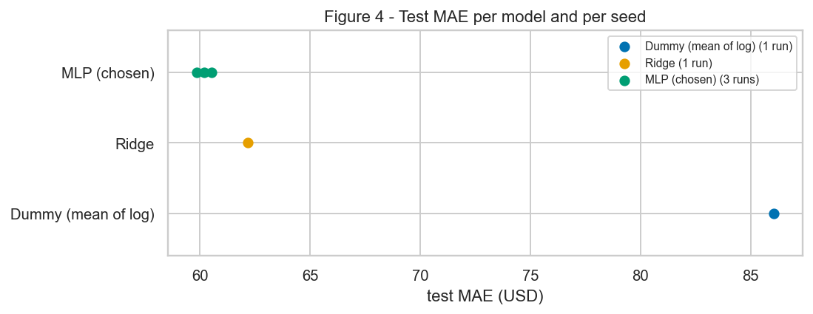

# Regression - NYC Airbnb price with a neural network

**Team:** Gustavo Cruz, Henrique Mayor and Pedro Fardin.

**Task:** regression. **Target:** `price` (USD per night). **Main metric:** MAE in dollars on the test set.

This is the second delivery of the project. The [EDA](../eda/index.md) built the preprocessing pipeline; here we train a multilayer perceptron on top of it and ask two questions: does the network learn something that simpler models do not, and how far can the number it reports be trusted?

Everything below comes out of one script, from a clean clone:

```bash
pip install -r requirements.txt
python code/regression.py    # about 4 minutes on a CPU
```

The script writes every figure to `figures/` and every number quoted here to [`results.json`](https://github.com/henriquessm/nyc-airbnb-project/blob/main/docs/projects/regression/results.json). The network and its training loop are in [`code/model.py`](https://github.com/henriquessm/nyc-airbnb-project/blob/main/code/model.py), the experiment in [`code/regression.py`](https://github.com/henriquessm/nyc-airbnb-project/blob/main/code/regression.py). Seeds are fixed everywhere (`random_state=42` for the split, seeds 42 to 44 for the networks), and the seed is set before the network is built, so it fixes the initial weights as well as the batch order. The numbers in this report were generated on a CPU; on a GPU the last decimals can differ.

---

## 0. Starting point

**Data and split.** Same file, same row filter (the 11 listings with `price == 0` removed) and the **same 80/20 split as the EDA**, seed 42, stratified on deciles of `log1p(price)`: 39,107 training rows and 9,777 test rows. The validation set comes out of the training set: 15% of it, with the same seed and the same stratification, so the three sets have the same price range (median $106 in all three).

| set | rows | used for |
|---|---|---|
| train | 33,240 | fitting the pipeline and every model |
| validation | 5,867 | early stopping, every choice of model and hyperparameter |
| test | 9,777 | section 5 only, once, after everything was frozen |

**Pipeline.** The `ColumnTransformer` from `code/preprocess.py` is imported as is and **fitted on the 33,240 training rows only**; validation and test are only transformed. Because it is fitted on fewer rows than in the EDA, five fewer neighbourhoods reach the 30-listing threshold, so the output has **119 features instead of 124**. Nothing else changed. The model is trained on `log1p(price)` (`transform_target()`, EDA section 1C: skewness 19.1 on the raw price, 0.63 on the log) and every prediction is brought back with `expm1` before any metric is computed, so **all metrics are in dollars**.

**Main metric: MAE in USD on the test set.** The target has a long tail (one listing at $10,000). RMSE squares the errors and would be decided by the 62 test listings at $1,000 or more; MAE treats a $50 error as a $50 error wherever it happens and is the number a host understands. RMSE and R² are reported next to it.

**Success criterion, written before training any network:**

> The network's test MAE (mean over 3 seeds) is **at least 10% lower than the MAE of the best baseline**, and the gap is larger than the variation between seeds.

Why 10% and not more: the EDA found that group means of log-price by room type × neighbourhood already explain 53.7% of its variance on the training set. A linear model with one-hot room type and neighbourhood captures most of that for free; what is left for the network is the 2-D shape of the map (EDA Figure 9) and the interactions between room type, location and how the listing is operated (EDA section 3C). A 10% cut in MAE on top of a linear model is what we expected those interactions to be worth.

---

## 1. Baselines

Both baselines use the same pipeline output (119 features) and the same log target, are fitted on train and evaluated on **validation**:

- **Trivial:** `DummyRegressor(strategy="mean")` on `log1p(price)`, which predicts the constant $113.12 for every listing.
- **Linear:** `Ridge`, with `alpha` chosen on validation among 0.01, 0.1, 1, 10 and 100. The MAE is $61.00 to $61.02 for every alpha up to 10 and $61.13 at 100: with 33,240 rows for 119 features the penalty barely matters. `alpha = 10` was kept.

| model (validation) | MAE ($) | RMSE ($) | R² |
|---|---|---|---|
| Dummy, mean of log (constant $113.12) | 85.96 | 240.07 | -0.031 |
| Ridge (`alpha=10`) | **61.00** | 221.40 | 0.124 |

Reading the table:

- Ridge removes **29% of the error of the trivial model** ($85.96 → $61.00). It is the best baseline, so it is the reference for the criterion of step 0.
- R² is low even for Ridge (0.12). R² is computed from squared errors in dollars, so it is dominated by the few listings at several thousand dollars, which no model gets right (section 6). The dummy's R² is slightly negative because it predicts the mean of the log-price ($113), which is below the mean price in dollars ($152).

---

## 2. The network

The network is a plain MLP in PyTorch (`code/model.py`, class `MLP`):

```
input (119) -> Linear 256 -> ReLU -> Linear 128 -> ReLU -> Linear 1
```

This is the base configuration: two hidden layers of **256 and 128 units**. The version that went to the test set has the same shape with half the widths, 128 and 64 (section 4). Every choice:

- **Two hidden layers.** The EDA showed a structure in two levels: a categorical cell first (room type × borough), then a continuous gradient inside the cell (EDA Figures 17-18). Two layers let the first build features such as "entire home in lower Manhattan" and the second combine them. A third layer was tried in the search (section 4) and made no real difference.
- **Widths 256 → 128.** The first layer is wider than the input (119) so that it has room for combinations of inputs, then the width halves towards the single output. The search also tried 128 → 64 and 512 → 256.
- **ReLU.** Its derivative is exactly 1 where the unit is active, so the gradient is not shrunk on the way back, and it is the default for MLPs on tabular data.
- **He (Kaiming) initialisation** for the hidden layers, biases at zero. ReLU zeroes about half of the units, which halves the variance of the signal at each layer; He compensates by drawing the weights with variance 2/n (n = number of inputs of the layer), so the signal keeps the same size from layer to layer.
- **Output: 1 linear unit**, no activation, because log-price is an unbounded real number.
- **Loss: MSE on `log1p(price)`** (`nn.MSELoss`), the standard loss for regression. Because the target is the log, a $10,000 listing predicted at about $110 is a residual of about 4.5, not of $9,900, so the squared error is no longer decided by a handful of rows.

**Number of parameters.**

| layer | base [256, 128] | chosen [128, 64] |
|---|---|---|
| hidden 1 | 119 × 256 + 256 = 30,720 | 119 × 128 + 128 = 15,360 |
| hidden 2 | 256 × 128 + 128 = 32,896 | 128 × 64 + 64 = 8,256 |
| output | 128 + 1 = 129 | 64 + 1 = 65 |
| **total** | **63,745** | **23,681** |

The base network has **1.92 parameters per training row** (63,745 / 33,240), the chosen one 0.71. Both have enough capacity to memorise noise, and Figure 1 shows the training loss still falling after the validation loss has stopped. This is why early stopping (section 3) is not optional.

---

## 3. Training

| setting | value | reason |
|---|---|---|
| optimizer | **AdamW** | Adam is the course's starting point for an MLP on tabular data: one learning rate works for all layers because each parameter's step is rescaled by the running size of its gradients. AdamW is Adam with the weight decay applied directly to the weights, which is what section 4 tests. |
| learning rate | **1e-3** | Adam's usual default. The search (section 4) tried 3e-4 and 3e-3 on the base network: 3e-3 is the worst configuration of the table ($60.00), 3e-4 is slightly better ($59.23 vs $59.67) but needs 47 epochs instead of 21. |
| batch | **256** | Inside the usual 32-512 range: 130 updates per epoch, a gradient that is neither too noisy nor too smooth. |
| epochs | **up to 300, patience 20** | Validation loss is evaluated after every epoch; training stops when it has not improved for 20 epochs and the **best weights are restored**. The validation curve has bumps that last 2-3 epochs (Figure 1), so a patience of 20 does not stop on noise. |

The loop (`train()` in `code/model.py`) is the course's skeleton: train on shuffled mini-batches, switch to `model.eval()` and compute the validation loss under `torch.no_grad()`, keep a copy of the `state_dict` whenever it improves, stop after `patience` epochs without improvement and load the best copy back. Both curves are computed in eval mode on the whole set at the end of each epoch.


**Reading Figure 1.** Both losses fall fast in the first five epochs (the validation loss is 0.334 after epoch 1) and the network **converges**: from about epoch 6 the validation loss hovers around 0.20 to 0.21, with bumps at epochs 14 and 28. Its **minimum is 0.1999 at epoch 21**; the training loss at that point is 0.1755. The training loss never stops falling (0.1621 at epoch 41, when early stopping fires) while the validation loss does not improve any more (0.2033). **The two curves separate from about epoch 6, and that is where overfitting starts:** everything the network learns after that is specific to the training rows. Early stopping gives back the epoch-21 weights.

---

## 4. Regularisation and hyperparameters

### Techniques compared

Two techniques, each added alone to the base network, same seed, same everything else, compared with the network without any. All numbers on validation, at the best epoch:

| variant | val MAE ($) | val loss | best epoch | gap (val - train loss) |
|---|---|---|---|---|
| **none** | **59.67** | 0.1999 | 21 | 0.0244 |
| weight decay 0.05 | 59.76 | 0.2002 | 21 | 0.0236 |
| dropout 0.2 | 59.80 | 0.2001 | 36 | 0.0149 |


- **Weight decay 0.05** (each step shrinks every weight a little towards zero) changes almost nothing. Each step multiplies the weights by (1 - lr·λ) = (1 - 5·10⁻⁵); over the 2,730 steps up to the best epoch that is a shrinkage of about 13%. The curves in Figure 2 are on top of the ones without it.
- **Dropout 0.2** (each hidden unit switched off with probability 0.2 during training, nothing switched off at evaluation) does what it is supposed to do: Figure 2(b) shows the gap between validation and training growing about half as fast, and the best epoch moves from 21 to 36. But the validation loss ends in the same place (0.2001 vs 0.1999) and the MAE is not better.

**Neither technique improved the validation MAE**: the three variants are within $0.13 of each other. Early stopping is already limiting the overfitting, and the two techniques have nothing left to add.

### Search

**8 configurations**: the base network and one change at a time from it (the two regularised variants above, three other sizes and two other learning rates). All trained with early stopping, batch 256, seed 42. The rule, fixed before running it, is the lowest validation MAE. Sorted:

| # | configuration | what changed | params | best epoch | val MAE ($) | val RMSE ($) | val R² |
|---|---|---|---|---|---|---|---|
| 1 | **[128×64] lr 1e-3** | smaller | 23,681 | 43 | **59.23** | 217.78 | 0.152 |
| 2 | [256×128] lr 3e-4 | lower learning rate | 63,745 | 47 | 59.23 | 217.01 | 0.158 |
| 3 | [512×256] lr 1e-3 | wider | 193,025 | 18 | 59.36 | 217.19 | 0.157 |
| 4 | [256×256×128] lr 1e-3 | one more layer | 129,537 | 21 | 59.42 | 217.65 | 0.153 |
| 5 | [256×128] lr 1e-3 | base | 63,745 | 21 | 59.67 | 217.76 | 0.152 |
| 6 | [256×128] lr 1e-3, weight decay 0.05 | weight decay | 63,745 | 21 | 59.76 | 217.70 | 0.153 |
| 7 | [256×128] lr 1e-3, dropout 0.2 | dropout | 63,745 | 36 | 59.80 | 218.29 | 0.148 |
| 8 | [256×128] lr 3e-3 | higher learning rate | 63,745 | 25 | 60.00 | 217.29 | 0.156 |

**Chosen: [128×64], ReLU, AdamW lr 1e-3, no weight decay, no dropout, batch 256.** The first two configurations tie at $59.23; the script keeps the first one in the list, which is also the one with 2.7 times fewer parameters, so we kept it.

**How much the ranking can be trusted.** Not much. The whole table spans $0.77. Section 5 retrains the chosen configuration with 3 seeds and its validation MAE goes from $59.23 to $59.53 (standard deviation $0.16) just by changing the seed. The top four are within $0.19 of each other, about one standard deviation, so they are the same model as far as this validation set can tell. What the table does say: size matters little (from 23,681 to 193,025 parameters, $0.44 of difference), and the highest learning rate is the worst.

---

## 5. Test evaluation

The chosen configuration was trained again from scratch with **3 seeds (42, 43, 44)**, each with early stopping on the same validation set, and each evaluated **once** on the test set. The baselines were fitted in section 1 and are evaluated on the same test rows. Nothing in sections 1-4 was chosen with the test set, and the test set was not used to change anything afterwards.

| model (test, 9,777 rows) | MAE ($) | RMSE ($) | R² |
|---|---|---|---|
| Dummy, mean of log | 86.06 | 267.74 | -0.025 |
| Ridge | 62.18 | 252.34 | 0.090 |
| **MLP, chosen (3 seeds)** | **60.20 ± 0.33** | **247.98 ± 0.81** | **0.121 ± 0.006** |

Per seed, the network's test MAE is $59.87, $60.53 and $60.19, with the best epoch at 43, 27 and 42.


**Figure 3.** (a) On log axes the cloud follows the diagonal from $30 to about $300 and then flattens: the network predicts more than $600 for only 4 test listings while 166 cost more than that, so the expensive end is underestimated, some listings by thousands of dollars. (b) In dollars the residuals fan out as the prediction grows (a $200 listing can be off by $200, a $50 one cannot), and the parallel curved stripes are the round prices hosts choose ($100, $150, $200) minus a smooth prediction; 83 points fall beyond ±$600.



**Was the criterion met? No.** The network's test MAE is **3.19% lower** than Ridge's ($60.20 vs $62.18); the criterion asked for 10% (a MAE of $55.96 or less).

**Is the gap larger than the variation between seeds? Yes.** The gap to Ridge is $1.98 and the network's standard deviation over seeds is $0.33, so the gap is **6.0 standard deviations**, and the worst seed ($60.53) is still $1.65 better than Ridge (Figure 4). The network is reliably better than the linear model, just by much less than we expected.

**Why RMSE and R² look so bad.** RMSE is 4.1 times the MAE (247.98 / 60.20), which means a few huge misses: the 62 test listings at $1,000 or more are enough to keep R² near 0.1 for every model. Section 6 shows which listings they are.

---

## 6. Error analysis

All numbers in this section use the seed-42 network on the test set (MAE $59.87). Nothing here was used to choose or change the model. "Bias" is the mean of prediction minus actual: negative means the network underestimates.


| group | n | MAE ($) | bias ($) | median price ($) | MAE / median price |
|---|---|---|---|---|---|
| Entire home/apt | 5,129 | 85.52 | -39.36 | 160 | 53% |
| Private room | 4,428 | 31.89 | -12.17 | 70 | 46% |
| Shared room | 220 | 25.42 | -9.93 | 49 | 52% |
| Manhattan | 4,301 | **84.40** | -43.03 | 150 | 56% |
| Brooklyn | 4,035 | 43.69 | -14.62 | 91 | 48% |
| Queens | 1,144 | 32.08 | -9.65 | 75 | 43% |
| Bronx | 219 | 29.69 | -7.92 | 65 | 46% |
| Staten Island | 78 | 37.01 | -14.05 | 67 | 55% |
| price < $50 | 1,003 | 18.97 | **+17.91** | 40 | 47% |
| $50-100 | 3,371 | 21.80 | +11.81 | 70 | 31% |
| $100-200 | 3,461 | 36.44 | +6.75 | 139 | 26% |
| $200-500 | 1,700 | 93.58 | -77.30 | 250 | 37% |
| **price ≥ $500** | 242 | **858.12** | -858.12 | 700 | 123% |

Patterns and our hypothesis for each:

1. **The error follows the price, and the model is pulled towards the middle.** Listings below $50 are overestimated by $17.91 on average, listings between $200 and $500 are underestimated by $77.30, and every one of the 242 listings above $500 is underestimated (the bias equals minus the MAE). *Hypothesis:* the features do not contain what makes a listing expensive within its cell (size, number of bedrooms, finish, view are not in the file), so the network predicts something close to the typical price of listings that look the same, and the extremes on both sides are pulled to it.
2. **Manhattan and entire homes have the largest errors in dollars**, $84.40 and $85.52, but relative to their median price they are not far from the rest (56% and 53%). *Hypothesis:* they are the most expensive cells and also the ones with the widest spread of prices (EDA Figure 10), so the same relative error is more dollars.
3. **Staten Island has a relative error (55%) as high as Manhattan's** although it is a cheap borough. *Hypothesis:* too few examples to learn its price level (78 test listings, 295 training listings in the EDA).

**The 10 worst predictions:**

| price ($) | predicted ($) | error ($) | neighbourhood | room | min nights | reviews | availability | title |
|---|---|---|---|---|---|---|---|---|
| 9,999 | 112 | 9,888 | East Harlem | Entire home | 5 | 1 | 0 | "Spanish Harlem Apt" |
| 10,000 | 204 | 9,796 | Upper West Side | Entire home | 30 | 0 | 83 | "1-BR Lincoln Center" |
| 7,500 | 59 | 7,441 | East Flatbush | Private room | 1 | 8 | 179 | "Gem of east Flatbush" |
| 7,703 | 546 | 7,157 | Upper East Side | Entire home | 1 | 0 | 146 | "East 72nd Townhouse by (Hidden by Airbnb)" |
| 6,000 | 255 | 5,745 | Greenwich Village | Entire home | 1 | 0 | 0 | "Luxury townhouse Greenwich Village" |
| 4,200 | 69 | 4,131 | Bedford-Stuyvesant | Private room | 114 | 0 | 347 | "Beautiful private Brooklyn room with kitchenette" |
| 3,900 | 153 | 3,747 | Greenwich Village | Entire home | 30 | 7 | 180 | "Greenwich Village Townhome with Private Garden!" |
| 4,000 | 320 | 3,680 | West Village | Entire home | 1 | 0 | 173 | "The Otheroom Bar/Event/Filming Space -read details" |
| 3,600 | 241 | 3,359 | Upper East Side | Entire home | 31 | 0 | 358 | "NYC HOLIDAY!!!! April 15- May 15" |
| 3,613 | 437 | 3,176 | Upper West Side | Entire home | 1 | 1 | 158 | "West 84th Street by (Hidden by Airbnb)" |

They fall into four groups, and none of them is fixed by a bigger network:

- **Placeholder prices** ($9,999 for a Spanish Harlem apartment with a closed calendar, $7,500 for a private room in East Flatbush). Nobody pays this; the host set the price to block bookings. The network's $112 and $59 are probably closer to what these places are worth.
- **Monthly prices in the nightly field** ($10,000 at 30 nights, $4,200 for a private room at 114 nights, $3,600 for "April 15 - May 15"). Four of the ten have a minimum stay of 30 nights or more.
- **Real luxury listings** (the townhouses, the "(Hidden by Airbnb)" listings from a 12-listing host). The price is real, but nothing in the features says "townhouse"; the title does.
- **Not lodging at all** ("Bar/Event/Filming Space").

### Permutation importance

For each of the 10 original columns we shuffled its values across the test rows (5 times, seed 42), passed the shuffled table through the fitted pipeline and measured how much the test MAE went up. Shuffling the raw column, before the pipeline, means `neighbourhood` and all its dummies count as one feature.


| column | MAE increase ($) |
|---|---|
| `room_type` | **26.12 ± 0.46** |
| `longitude` | 8.92 ± 0.25 |
| `minimum_nights` | 8.52 ± 0.31 |
| `neighbourhood` | 8.13 ± 0.26 |
| `availability_365` | 7.69 ± 0.35 |
| `calculated_host_listings_count` | 5.24 ± 0.25 |
| `number_of_reviews` | 4.46 ± 0.20 |
| `reviews_per_month` | 2.90 ± 0.24 |
| `latitude` | 2.89 ± 0.09 |
| `neighbourhood_group` | 2.47 ± 0.16 |

**Does it match the EDA?** Mostly yes, with one surprise.

- *Room type first.* The EDA said room type is the strongest single predictor (entire homes at 2.3× a private room, Figure 10). Shuffling it costs $26, about three times more than any other column.
- *Location second, and longitude more than latitude.* `longitude` and `neighbourhood` are among the next three columns. The EDA found the same order between the coordinates: Spearman -0.44 with price for `longitude`, 0.13 for `latitude` (prices go up towards Manhattan, to the west). The borough is last, which does not mean it is useless: its information is also in the neighbourhood and in the coordinates, so the network can do without it.
- *The surprise: the "how the listing is operated" features matter.* The EDA found weak rank correlations between price and availability, minimum nights or host portfolio size (all below 0.11 in absolute value). For the network they are about as important as the location columns ($8.52, $7.69 and $5.24). They act through interactions (a 30-night minimum means something different in Manhattan and in the Bronx), which a correlation with the target cannot see.
- *The redundant pair.* `reviews_per_month` is among the three least important columns, consistent with the EDA's finding that it overlaps with `number_of_reviews` (Spearman 0.71). It is the first column we would drop.

---

## 7. Conclusion

**Was the network worth it?** Only partly. It beats the linear baseline by 3.19% on the test MAE ($60.20 vs $62.18), a gap 6.0 times the variation between seeds, so the improvement is real. But it missed the 10% we set as the criterion, and it costs minutes of training and a hyperparameter search where Ridge takes a second. The search itself points to the reason: networks from 23,681 to 193,025 parameters, with or without regularisation, all land within $0.77 of each other. More capacity does not help, so the remaining error is in the data, not in the model.

**Limitations.**

- The features cannot see size or quality. Section 6 shows the largest errors are real luxury listings or prices that are not nightly prices, and nothing in the 10 columns separates them from ordinary listings.
- The target itself is noisy: placeholder prices and monthly prices are in the training set too, and with a squared-error loss the network is pulled by them.
- The split is random by listing, as the course asks, but one host can own up to 327 listings with a shared pricing policy (EDA section 5). A split grouped by `host_id` would probably give a higher test error.
- It is a mid-2019 snapshot. Prices have changed since, and New York's 2023 short-term rental rules removed a large part of these listings from the market. The model should not be used on today's prices.
- The hyperparameter ranking is within seed noise (section 4); the chosen configuration is one of several equivalent ones.

**Who would be affected by an error.** A host who used the model to set a price would be pushed towards the typical price of similar listings. For a cheap listing (under $50) the model overestimates by $17.91 on average, so a host in the Bronx or Queens following it would price above the market and lose bookings, and that is the group with the least room for a loss. For an expensive listing the model underestimates by hundreds of dollars, so the owner would leave money on the table. Any use like this should come with a range, not a single number.

**With more time** we would: (1) clean the target, removing or flagging placeholder prices and dividing monthly prices by 30; (2) use a loss that is less sensitive to those prices, such as Huber; (3) add features from the `name` column ("townhouse", "month", "event space"); (4) compare with a tree model such as gradient boosting, which often ties with a network on tables; (5) evaluate with a split grouped by host.

### Results summary

| # | Summary | Value |
|---|---|---|
| 1 | Dataset, task, target and main metric | NYC Airbnb Open Data 2019 (Kaggle) · regression · `price` (USD / night), trained on `log1p(price)` · MAE in USD on the test set |
| 2 | Train · validation · test (rows) | 33,240 · 5,867 · 9,777 (validation = 15% of the EDA's 39,107 training rows; same split and seed as the EDA) |
| 3 | Best baseline and its test metric | Ridge (`alpha=10`): test MAE $62.18 (trivial: $86.06) |
| 4 | Chosen network: layers × units, number of parameters, regularization | 2 hidden layers [128, 64], ReLU, He init, 1 linear output, MSE loss · 23,681 parameters (0.71 per training row) · early stopping only (weight decay and dropout were compared and did not help) |
| 5 | Optimizer, learning rate, batch and the epoch it stopped at | AdamW, lr 1e-3, no weight decay, batch 256 · best epoch 43 (seed 42; 27 to 43 over the 3 seeds), patience 20 |
| 6 | The network's main metric on the test set (mean ± std, 3 seeds) | MAE $60.20 ± $0.33; RMSE $247.98 ± 0.81, R² 0.121 ± 0.006 |
| 7 | Success criterion met? | No: 3.19% lower MAE than Ridge, the criterion was 10% ($55.96). The gap to Ridge ($1.98) is 6.0 seed standard deviations |
| 8 | Subgroup with the largest error and its value | Listings priced ≥ $500: MAE $858.12 (n = 242). Among the EDA categories: entire homes, MAE $85.52 (n = 5,129), and Manhattan, MAE $84.40 (n = 4,301) |
